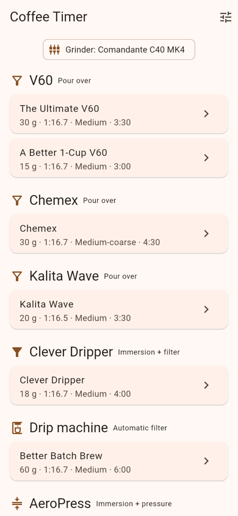
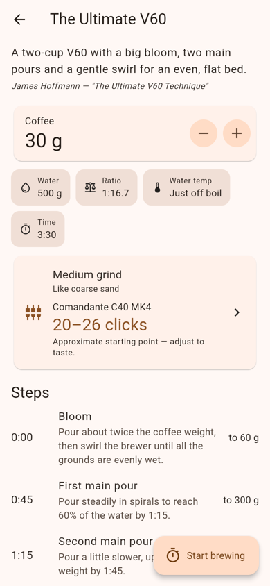
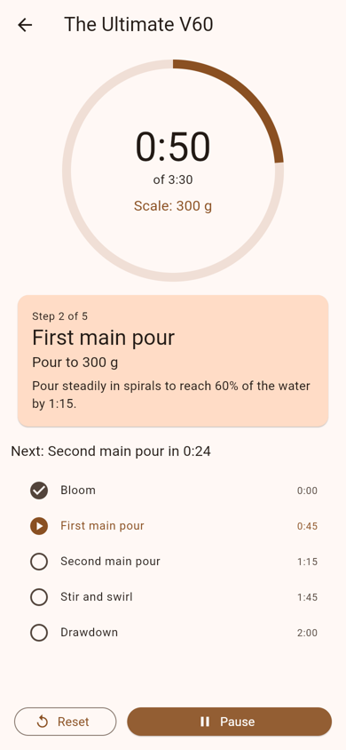

# Coffee Timer

A Flutter coffee brewing timer with recipes based on James Hoffmann's
methods and grind settings for popular hand grinders.

<p>
  
  
  
</p>

## Features

- **13 recipes across 12 brew methods:** V60 (Ultimate and 1-cup), Chemex,
  Kalita Wave, Clever Dripper, drip machine, AeroPress, French press,
  moka pot, espresso, cold brew, Japanese iced pour over and Turkish coffee.
  Each recipe names its source; ones Hoffmann hasn't published directly are
  marked as adaptations.
- **Step-by-step timer:** shows the current step, the scale target for each
  pour and a countdown to the next step, with a haptic + sound cue on each
  step change.
- **Dose scaling:** change the coffee dose and every water and pour target
  scales with it.
- **Grinder settings** for Comandante C40, 1Zpresso Q Air, K-Ultra, JX-Pro
  and J-Max, Kingrinder K4 and K6, Timemore C3 and S3, Hario Skerton Pro and
  Porlex Mini II. Your grinder choice is remembered.

Grinder settings are approximate starting points, counted in clicks from
zero (burrs just touching). Grinders vary unit to unit, so dial in by taste:
sour or fast, go finer; bitter or slow, go coarser.

## Install on Android

Every push to `main` builds an APK on GitHub Actions and attaches it to the
[latest release](https://github.com/jcosmith/wake-up/releases/tag/latest).
Download `app-release.apk` on your phone and allow installs from unknown
sources when prompted.

## Running

```sh
flutter pub get
flutter run          # pick a device, or -d chrome for the web
flutter test
```

## Project layout

```
lib/
  data/        recipes.dart, grinders.dart — all brewing data lives here
  models/      Recipe, BrewStep, HandGrinder, GrindSize, BrewSession (timer logic)
  screens/     home, recipe, timer, grinder settings
  state/       selected grinder (persisted with shared_preferences)
```

To add a recipe or grinder, add an entry to the matching file in `lib/data/`;
the tests in `test/data_test.dart` check that steps are ordered, pours add up
to the recipe's water, and grinder settings get coarser with grind size.
